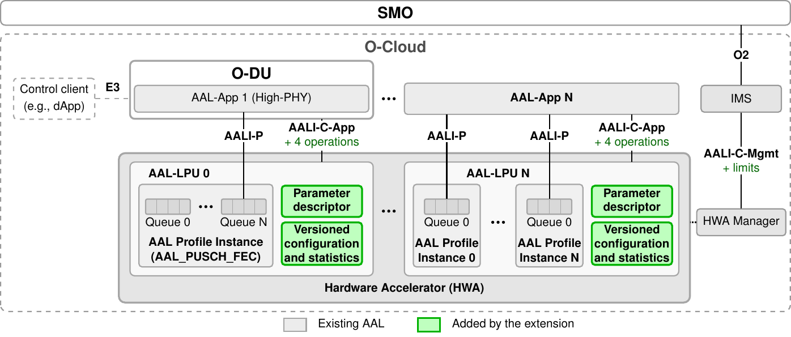
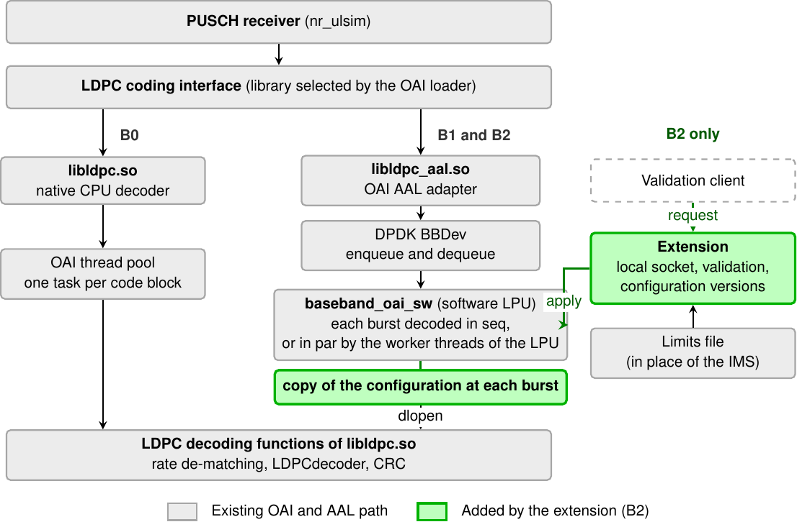
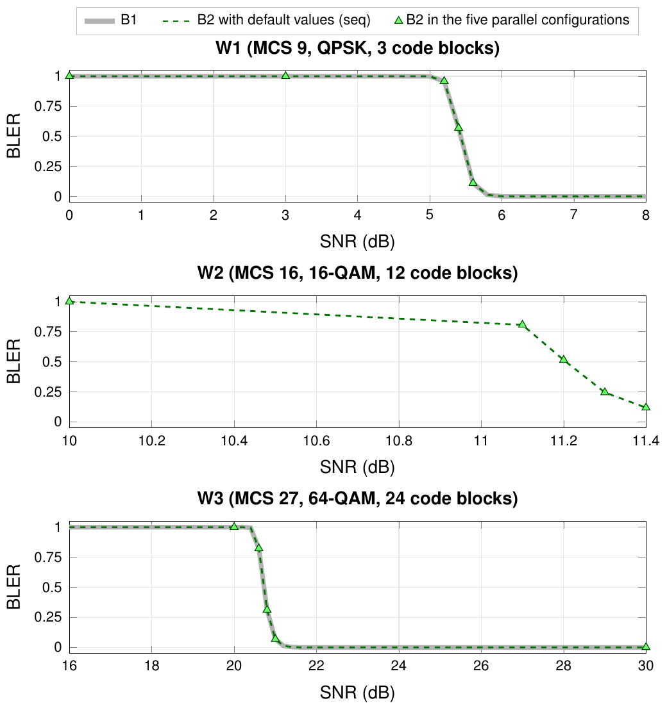
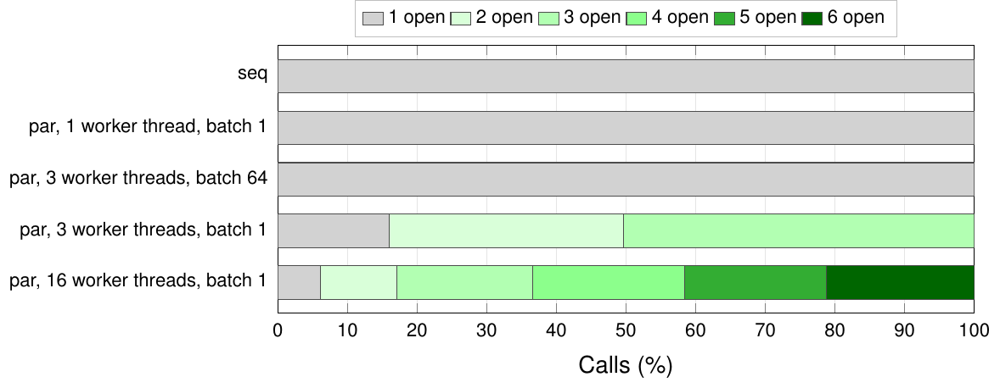
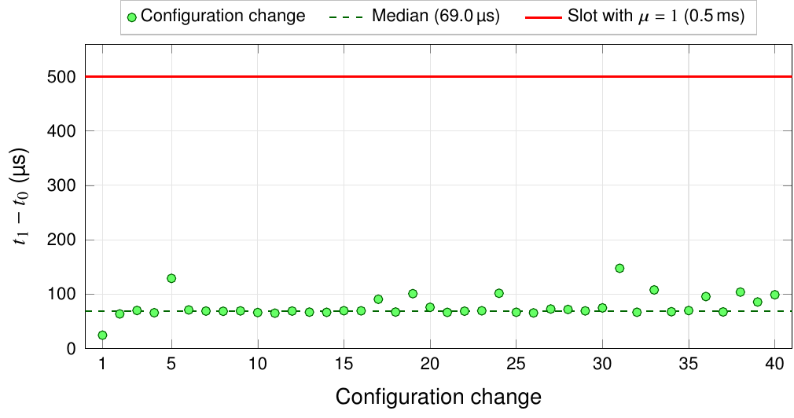
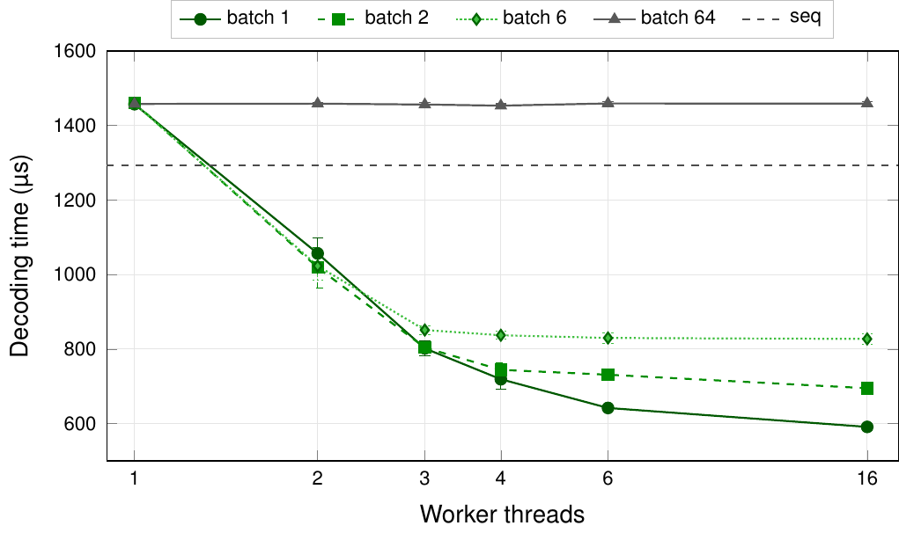

# Runtime Execution Parameters for the O-RAN AAL

This repository contains the prototype, the experiment scripts, and the raw data of the undergraduate thesis
*Extending the O-RAN Acceleration Abstraction Layer for Runtime Reconfiguration of Accelerator Execution Parameters*
(Murilo Schuck, UNISINOS, 2026).

The thesis proposes an extension to the O-RAN Acceleration Abstraction Layer (AAL) that makes the execution
parameters of a Logical Processing Unit (LPU) discoverable and configurable at runtime, within limits set by the
infrastructure. Each LPU publishes a typed descriptor of its runtime parameters, the infrastructure bounds them
through the existing management interface, and four new operations of the AALI-C-App allow the application to
discover, apply, read, and observe the configuration. Changes are versioned and take effect from the next burst of
operations, without stopping the LPU, while the AALI-P remains unchanged.

The prototype is built on [OpenAirInterface](https://gitlab.eurecom.fr/oai/openairinterface5g) (OAI). A software LPU,
`baseband_oai_sw`, executes the AAL_PUSCH_FEC profile (rate de-matching, LDPC decoding, and CRC check) behind the
DPDK BBDev interface and publishes three runtime parameters: the decoding mode, the number of worker threads, and
the batch size.

<p align="center"></p>

## Repository structure

```
.
├── oai/            OAI fork (git submodule), fixed at tag tcc-2026
├── patches/        the changes to OAI, as a single patch over the upstream base commit
├── experiments/    scripts, raw data, and analyses of every experiment in the thesis
└── img/            figures of the thesis
```

Clone with the submodule:

```bash
git clone --recurse-submodules https://github.com/muriloschuck/aal-runtime-parameters.git
```

## What changed in OAI

The work is based on the OAI `develop` branch at commit
[`cfee4c2`](https://github.com/duranta-project/openairinterface5g/commit/cfee4c20b45ac1cf6d455d3f01bb3e00200438b0)
(23 Oct 2026, merge of `integration_2026_w43`). The fork
[`muriloschuck/openairinterface5g`](https://github.com/muriloschuck/openairinterface5g), branch `tcc/aal-sw`, adds
the changes below. The code used in all experiments is commit `8098388`; the tag `tcc-2026` contains the same code.

| File (under `openair1/`) | Change |
|---|---|
| `PHY/CODING/nrLDPC_coding/nrLDPC_coding_aal/bbdev_oai_sw.c` | new: software LPU registered as a BBDev virtual device |
| `PHY/CODING/nrLDPC_coding/nrLDPC_coding_aal/aal_compute_ext.c` | new: the extension (descriptor, effective domain, operations, control socket) |
| `PHY/CODING/nrLDPC_coding/nrLDPC_coding_aal/aal_compute_ext.h` | new: descriptor types and registration interface |
| `PHY/CODING/nrLDPC_coding/nrLDPC_coding_aal/nrLDPC_coding_aal.c` | integration of the extension into the OAI AAL adapter |
| `PHY/CODING/nrLDPC_coding/nrLDPC_coding_aal/CMakeLists.txt` | build option `ENABLE_LDPC_AAL_EXT` |
| `PHY/CODING/nrLDPC_coding/nrLDPC_coding_aal/tests/` | unit test of the extension (`test_aal_compute_ext`) |
| `PHY/CODING/nrLDPC_coding/nrLDPC_coding_aal/README.md` | documentation of the extension |
| `SIMULATION/NR_PHY/ulsim.c` | small adjustment to the link-level simulator |

The same changes are in
`patches/oai-aal-runtime-parameters.patch`, which applies to the upstream base commit:

```bash
git clone https://github.com/duranta-project/openairinterface5g.git
cd openairinterface5g
git checkout cfee4c20b45ac1cf6d455d3f01bb3e00200438b0
git apply ../patches/oai-aal-runtime-parameters.patch
```

The extension is documented in
`oai/openair1/PHY/CODING/nrLDPC_coding/nrLDPC_coding_aal/README.md` (section *Compute Extension*).

## Requirements

The experiments ran on the machine below. The full list of versions is in `experiments/AMBIENTE.md`.

| Item | Version used |
|---|---|
| CPU | Intel Core i5-8300H, 4 cores, 8 threads |
| Kernel | Linux 7.0.0-38-generic (7.0.0-42-generic in the 15-round timing run) |
| DPDK | 24.11.2 |
| Compiler | gcc 15.2.0 |
| Tracing and debugging | bpftrace v0.25.0, gdb 17.1 |
| Analyses | Python 3.14 and matplotlib 3.10 |
| Hugepages | 2 GB of 2 MB pages (`sudo dpdk-hugepages.py -p 2M --setup 2G`) |

## Builds

Three builds are compared in the thesis:

| Build | Description | CMake options |
|---|---|---|
| B0 | unmodified OAI decoder (`libldpc.so`), without the AAL | (any build; `nr_ulsim` loads `libldpc.so`) |
| B1 | standard AAL path with the software LPU, extension compiled out | `-DENABLE_LDPC_AAL=ON -DENABLE_LDPC_AAL_EXT=OFF` |
| B2 | extended AAL | `-DENABLE_LDPC_AAL=ON -DENABLE_LDPC_AAL_EXT=ON` |

<p align="center"></p>

The experiments used `-DCMAKE_BUILD_TYPE=RelWithDebInfo -DENABLE_TESTS=ON`, with B2 in `oai/build/` and B1 in
`oai/build/b1/`. The race-detection run used a separate build, `oai/build_tsan/`, with `-DSANITIZE_THREAD=ON`.
For the general OAI build steps, see `oai/doc/LDPC_OFFLOAD_SETUP.md`.

The unit test of the extension does not need DPDK:

```bash
cd oai/build && ctest -R test_aal_compute_ext
```

In B1 and B2, `nr_ulsim` loads the AAL adapter and the software LPU with:

```bash
--loader.ldpc.shlibversion _aal \
--nrLDPC_coding_aal.dpdk_dev baseband_oai_sw \
--nrLDPC_coding_aal.dpdk_core_list 0-1
```

In B2, the extension listens on a UNIX socket (default `/tmp/aal_ext.sock`), one request per line and one JSON
object per response. The options `ctl_sock`, `limits`, and `compute` of the `nrLDPC_coding_aal` section set the
socket path, the infrastructure limits file, and the initial configuration.

## Reproducing the experiments

Each folder of `experiments/` holds one experiment, with `scripts/` (what generated the data), `dados/` (raw output),
and `analise/` (tables and figures derived from the data). `experiments/README.md` describes every folder, command,
and analysis in detail, and `experiments/registros/` holds the daily logs with each command and its full output.

| Folder | Thesis section | What it evaluates |
|---|---|---|
| `b0xb1/` | 6.1 | software LPU: B0 and B1 decode identically |
| `e1/contagens/` | 6.2 | compatibility: B1 and B2 with default values give identical error counts |
| `e2/contagens/`, `e2/concorrencia/`, `tsan/` | 6.2 | result invariance: parallel configurations give the same output as sequential decoding, with real concurrency and no data races |
| `e3/` | 6.3 | interface contract and in-service reconfiguration |
| `e2/tempo/`, `e2/saturacao/` | 6.4 | effect of the parameters on decoding time |
| `e1/tempo/` | 6.4 | overhead of the extension with default values |
| `ambiente_tempo/` | 5.2 | measurement noise of the machine |

The execution scripts find OAI in `oai/` and write new runs to `saidas/`; both paths can be changed with the
environment variables `OAI` and `SAIDAS` (see `experiments/comum/caminhos.sh`). Runs that use DPDK need `sudo`.
The analyses only read `dados/` and do not need `sudo`.

The scripts were adapted after the experiments to replace absolute paths of the original machine with these
variables. The versions that generated the data, and the matching `SHA256SUMS`, are in the fork at tag `tcc-2026`,
under `tools/tcc/`.

## Main results

Block error rate of the first transmission for B1, for B2 with default values, and for B2 in each parallel
configuration. The curves overlap, with identical error counts in all groups.

<p align="center"></p>

Number of decodings open when each call to the LDPC decoding function started, in W3.

<p align="center"></p>

Time from each configuration request to its effect in the AAL implementation, for 40 changes applied during decoding.

<p align="center"></p>

Decoding time in W3 for each combination of worker threads and batch size, with 95% confidence intervals over
15 rounds.

<p align="center"></p>

## How to cite

```bibtex
@thesis{schuck2026aal,
  author = {Schuck, Murilo},
  title  = {Extending the O-RAN Acceleration Abstraction Layer for Runtime Reconfiguration of Accelerator Execution Parameters},
  type   = {Bachelor's thesis},
  school = {Universidade do Vale do Rio dos Sinos (UNISINOS)},
  year   = {2026}
}
```

## License

The OAI code in `oai/` and the changes in `patches/` are distributed under the
[OAI Public License V1.1](https://github.com/duranta-project/openairinterface5g/blob/develop/LICENSE), like OAI.
The scripts, data, and documentation in `experiments/` and `img/` are distributed under the MIT License (see `LICENSE`).
